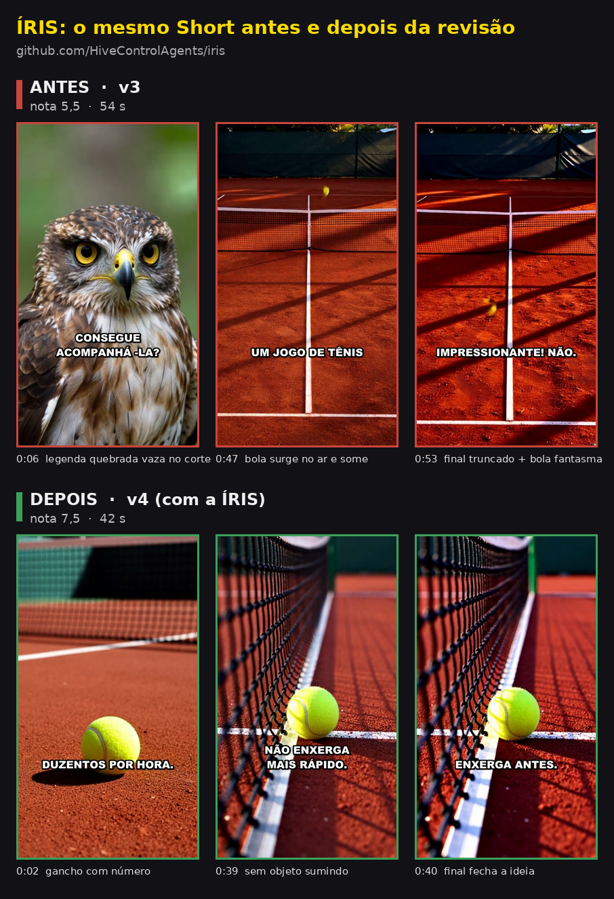

# ÍRIS: a revisora de vídeos gerados por IA

Ferramentas de vídeo com IA geram. A ÍRIS **revisa**: assiste o vídeo quadro a quadro, aponta cada defeito com o
segundo exato, manda gerar de novo só as cenas ruins e guarda o que aprendeu para o próximo vídeo sair melhor.

Ela nasceu dentro de uma fábrica de YouTube Shorts que roda toda noite sozinha. Lá, cada vídeo passa pela ÍRIS antes
de ser publicado. Este repositório é a ÍRIS empacotada como plugin do Claude Code, para revisar os vídeos de qualquer
pipeline (Wan, Veo, Kling, Runway, CapCut, edição manual, tanto faz).

```
gerar  ->  inspecionar  ->  revisar  ->  refazer só as cenas ruins  ->  aprender
```

## Antes e depois

O mesmo Short de curiosidade, antes e depois de passar pela ÍRIS:



| | Antes (v3) | Depois (v4) |
|---|---|---|
| Nota | 5,5 | 7,5 |
| Duração | 54 s | 42 s |
| Objeto surgindo ou sumindo | bola aparece no ar e some (0:47) | nenhum |
| Final | frase truncada | fecha a ideia do gancho |

Revisões completas: [v3](demo/tenis-v3/revisao.md) e [v4](demo/tenis-v4/revisao.md). A ÍRIS também apontou o que
ainda falta no v4 (áudio 2 dB baixo, legenda semitransparente que se repete), porque revisar não é só elogiar.

## O que ela entrega

- **Nota** de 0 a 10 e um resumo de uma frase.
- **Defeitos com o segundo exato**: objeto que some ou duplica, mão deformada, texto inventado na imagem, salto
  brusco, cena congelada, voz que mudou, palavra engolida, áudio baixo, legenda longa demais.
- **Sorteio ou pipeline**: separa o azar de uma geração (outra semente resolve) do defeito que vai se repetir.
- **Lista de cenas para refazer** (no máximo 3), com o ajuste de prompt sugerido.
- **Lições** acumuladas em `.iris/historico.json`. Lição que se repete sobe de prioridade.

Roda dentro do Claude Code: **não precisa de chave de API**, porque quem assiste as folhas de contato é o próprio
Claude da sua sessão.

## Instalar

Requisitos: [Claude Code](https://claude.com/claude-code), Python 3.10+, `ffmpeg` no PATH e `pip install Pillow`.

```
/plugin marketplace add HiveControlAgents/iris
/plugin install iris@iris
```

Opcionais: `pip install faster-whisper` (compara a narração com o roteiro) e `pip install librosa` (confere se a
voz é a mesma da gravação de referência).

## Usar

```
/iris meu_video.mp4
/iris meu_video.mp4 roteiro.json
```

Ou só peça: "revisa esse vídeo". A revisão sai em `.iris/<nome-do-video>/revisao.md` e `revisao.json`.

- Formato do roteiro: [exemplos/roteiro.json](exemplos/roteiro.json). Sem roteiro, as cenas são detectadas pelos cortes.
- Regras do seu canal (por exemplo "sem pessoas", "sem texto na imagem"): copie
  [exemplos/regras.md](exemplos/regras.md) para `.iris/regras.md`.
- O inspetor também roda sozinho, sem o Claude:
  `python skills/revisar-video/scripts/inspecionar.py video.mp4` gera `medidas.json` e as folhas de contato.

## Como funciona

1. `inspecionar.py` mede com ffmpeg: duração, resolução, loudness (LUFS) e pico, cortes bruscos, congelamentos,
   telas pretas, brilho e saturação por cena. Com roteiro, compara o texto com o que foi dito.
2. Monta **folhas de contato**: 2 quadros por segundo, 6 por linha, com o tempo em amarelo no canto. É assim que o
   Claude enxerga um objeto sumindo entre dois quadros vizinhos.
3. O Claude lê medidas, folhas, regras do canal e histórico, e escreve a revisão seguindo [critérios](skills/revisar-video/criterios.md).
4. O histórico é atualizado. No vídeo seguinte, padrões repetidos viram correção de pipeline em vez de azar.

## E o que já existe?

- [claude-video](https://github.com/bradautomates/claude-video), [claude-video-vision](https://github.com/jordanrendric/claude-video-vision)
  e skills parecidas fazem o Claude **assistir** um vídeo para responder perguntas ou resumir. A ÍRIS **julga** um
  vídeo gerado por IA: mede, aponta defeito com o segundo exato, decide o que refazer e aprende entre vídeos.
- [VISTA](https://g-vista.github.io/) (pesquisa do Google) melhora prompts de vídeo em ciclos de crítica. A ÍRIS
  segue a mesma família de ideia, mas é uma ferramenta prática para quem publica Shorts: roda no Claude Code, sem
  chave de API, sobre o pipeline que você já tem.

## Créditos

Criada por **Isaque Moutta** ([@IsaqueMoutta](https://github.com/IsaqueMoutta)), dentro da Colmeia, a equipe de
agentes da [HiveControlAgents](https://github.com/HiveControlAgents).

Se a ÍRIS ajudou seus vídeos, dê o crédito: cite "Revisado pela ÍRIS, de Isaque Moutta" com o link deste
repositório na descrição do vídeo, no README do seu projeto ou no seu post. Se você copiar ou adaptar o código, a
licença MIT exige manter o aviso de copyright do arquivo [LICENSE](LICENSE).

## Licença

MIT. Copyright (c) 2026 Isaque Moutta. Veja [LICENSE](LICENSE).

---

## English

**ÍRIS** is a Claude Code plugin that reviews AI-generated short videos frame by frame. It measures the video with
ffmpeg, builds timestamped contact sheets, and has Claude point out every defect with the exact second, tell apart
one-off generation noise from pipeline bugs, list which scenes to regenerate (max 3), and keep a growing list of
lessons in `.iris/historico.json`. No API key needed: it runs inside your Claude Code session.

Install: `/plugin marketplace add HiveControlAgents/iris` then `/plugin install iris@iris`. Use: `/iris video.mp4`.
Output and prompts are in Brazilian Portuguese for now; ask Claude to answer in your language.

Created by **Isaque Moutta** ([@IsaqueMoutta](https://github.com/IsaqueMoutta)). If ÍRIS helps your videos, please
credit "Reviewed by ÍRIS, by Isaque Moutta" with a link to this repository. MIT license: keep the copyright notice
in any copy or fork.
